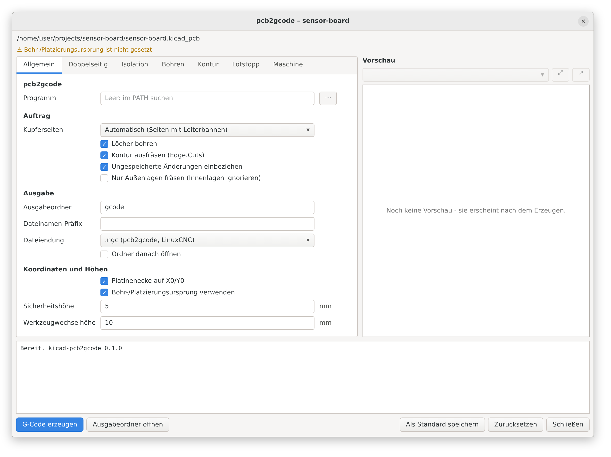
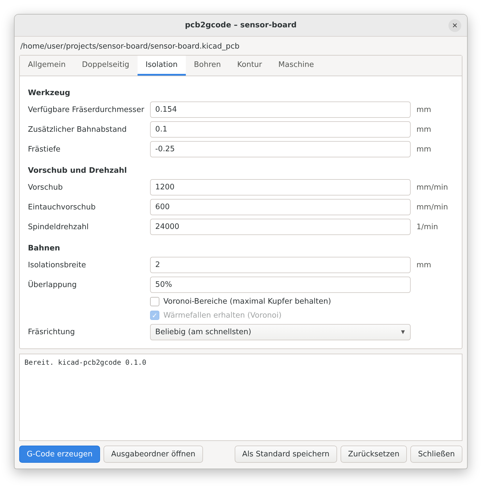
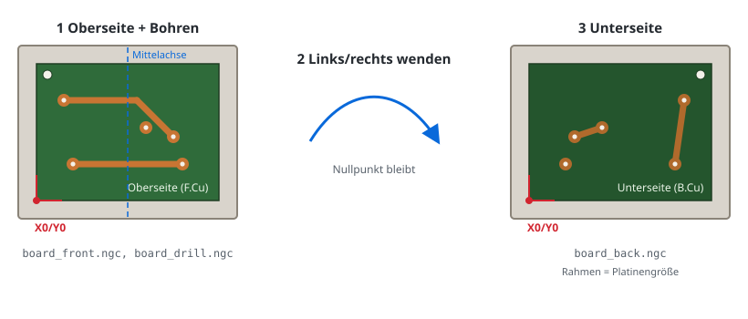
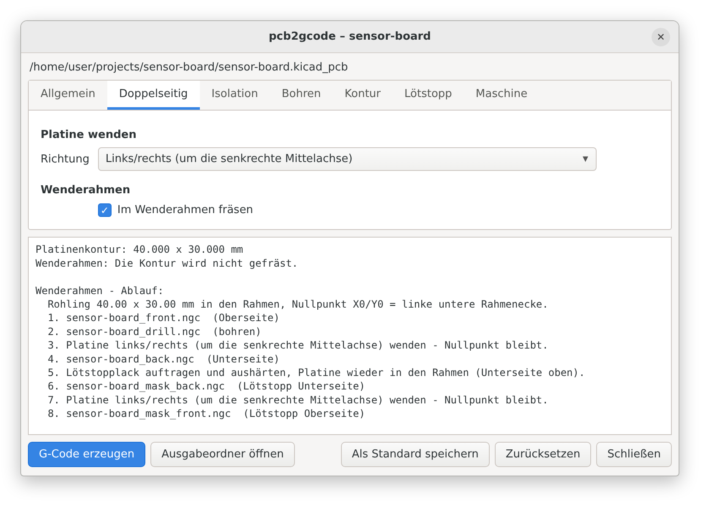
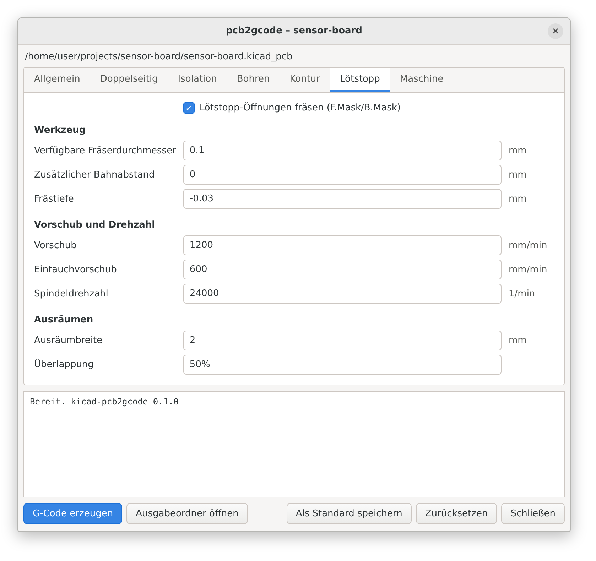

# kicad-pcb2gcode

Ein Plugin für KiCad 9/10, das das im Leiterplatteneditor geöffnete Board mit
[pcb2gcode](https://github.com/pcb2gcode/pcb2gcode) in CNC-G-Code umwandelt:
Isolationsfräsen, Bohren und Platinenkontur, mit Voreinstellungen für
GRBL-Fräsen.

*English: [README.md](README.md)*

Ein Klick auf den Toolbar-Button öffnet ein Einstellungsfenster.
**G-Code erzeugen** dann

1. exportiert Kupferlagen, `Edge.Cuts` und Bohrdatei mit `kicad-cli` – aus
   einer Kopie des Boards, wie es gerade in KiCad offen ist. Ungespeicherte
   Änderungen sind also dabei, und deine Datei bleibt unangetastet.
2. erkennt, welche Kupferseiten tatsächlich Leiterbahnen haben,
3. schreibt eine `millproject`-Datei und startet pcb2gcode,
4. legt den G-Code im Ordner `gcode/` neben dem Board ab.

<p>
  
  
</p>

<sub>Vorschau, gezeichnet aus den Felddefinitionen des Dialogs mit
<code>scripts/render_previews.py</code>. Das echte Fenster sieht je nach
Betriebssystem etwas anders aus.</sub>

## Voraussetzungen

| | |
|---|---|
| KiCad | 9.0 oder neuer, mit aktivierter API (siehe unten) |
| pcb2gcode | 2.5 oder neuer (3.x empfohlen) – [Releases](https://github.com/pcb2gcode/pcb2gcode/releases), `apt install pcb2gcode`, `brew install pcb2gcode` |
| nur Linux | wxPython aus dem System für das Einstellungsfenster, z. B. `sudo apt install python3-wxgtk4.0` (meist schon durch KiCad installiert) |

Das Plugin ist reines Python. KiCad legt die Python-Umgebung selbst an und
installiert `kicad-python` automatisch.

## Installation

1. `kicad-pcb2gcode-<version>.zip` aus den
   [Releases](https://github.com/brln-devlabs/kicad-pcb2gcode/releases)
   herunterladen und in den Plugin-Ordner von KiCad entpacken:

   | System | Ordner |
   |---|---|
   | Windows | `Dokumente\KiCad\<version>\plugins\` |
   | macOS | `~/Documents/KiCad/<version>/plugins/` |
   | Linux | `~/.local/share/kicad/<version>/plugins/` |

   Danach muss es `…/plugins/kicad-pcb2gcode/plugin.json` geben.
   Alternativ das Repository klonen und `python scripts/install.py` ausführen.
2. In KiCad: **Einstellungen → Einstellungen → Plugins → KiCad-API aktivieren**.
3. KiCad neu starten. Beim ersten Start richtet KiCad kurz die
   Python-Umgebung des Plugins ein. Danach erscheint der Button **pcb2gcode**
   in der Toolbar des Leiterplatteneditors.

## Benutzung

Board öffnen, Toolbar-Button drücken, Einstellungen prüfen,
**G-Code erzeugen** klicken. Die Reiter:

* **Allgemein** – welche Kupferseiten gefräst werden (automatisch, oben,
  unten, beide), Bohren und Kontur an/aus, Ausgabeordner, Nullpunkt,
  Sicherheits- und Werkzeugwechselhöhe, Pfad zu pcb2gcode.
* **Isolation** – verfügbare Fräserdurchmesser (die Breite, die dein
  Werkzeug in der Frästiefe schneidet; einer oder mehrere), Tiefe,
  Vorschübe, Isolationsbreite, Überlappung (Prozent oder Länge),
  Voronoi-Modus – dieselben Felder wie in pcb2gcodeGUI.
* **Bohren** – Tiefe, Vorschub, verfügbare Bohrergrößen, große Löcher fräsen;
  durchkontaktierte (PTH) und nicht durchkontaktierte (NPTH) Löcher zusammen in
  einer Datei (Voreinstellung), getrennt in zwei Dateien (`<board>_drill.ngc`
  und `<board>_npth_drill.ngc`) oder nur eine Art.
* **Kontur** – Fräser, Zustellung pro Durchgang, Haltestege.
* **Lötstopp** – fräst die Öffnungen von `F.Mask`/`B.Mask` frei (standardmäßig
  an), siehe unten.
* **Maschine** – G-Code-Dialekt und zusätzliche pcb2gcode-Optionen.

Neben den Reitern zeigt eine **Vorschau** die Bilder, die pcb2gcode zeichnet,
wie bei pcb2gcodeGUI: Kupfer mit Fräsbahnen je Seite, Bohrungen, Kontur,
Lötstopp – und ganz oben Stellen, an denen der Abstand nicht eingehalten werden
konnte. Sie füllt sich nach **G-Code erzeugen** und zeigt beim Öffnen des
Fensters die Bilder des letzten Laufs. Mit dem Mausrad wird flüssig um den Mauszeiger
gezoomt, Ziehen mit linker oder mittlerer Taste verschiebt die Ansicht,
Doppelklick oder **⤢** passt das Bild wieder ein. Gezeichnet wird aus den Vektorpfaden,
auch während des Zoomens und Verschiebens – das Bild bleibt in jeder
Vergrößerung scharf. Große Bilder werden auf das vereinfacht, was der Bildschirm
zeigen kann (unter einem halben Pixel), und in Kacheln genau in der aktuellen
Vergrößerung vorgehalten. Die Bilder liegen in
`gcode/preview/`;
**↗** öffnet das gewählte im Webbrowser (nötig mit wxPython älter als 4.1, das
kein SVG zeichnen kann).

Gerber- und Bohrdateien werden relativ zu KiCads Bohr-/Platzierungsursprung
exportiert (**Bohr-/Platzierungsursprung verwenden**, standardmäßig an – wie die
gleichnamige Option im Plotten-Dialog von KiCad). Steht dieser Ursprung noch auf
0/0, weist ein kleiner
Hinweis unter dem Dateinamen darauf hin (Details per Mauszeiger), und das
Protokoll wiederholt ihn. Mit **Platinenecke auf X0/Y0** hängt der G-Code nicht
von diesem Ursprung ab; er zählt nur, wenn **Bohr-/Platzierungsursprung
verwenden** an und die Platinenecke aus ist.

Die Voreinstellungen stammen aus einer bewährten pcb2gcodeGUI-Einstellung
für eine GRBL-Fräse mit 24 000 1/min: ein Gravierstichel, der in 0,25 mm Tiefe
0,154 mm breit schneidet (0,1 mm zusätzlicher
Bahnabstand), ein Bohrer für alle Löcher, ein 1,5-mm-Fräser für die Kontur in
einem Durchgang von 2,5 mm mit zwei Haltestegen à 0,5 mm. Eine Abweichung:
Die Isolationsbreite ist 1 mm statt 2 mm – bei Kupferflächen fräsen 2 mm kaum
mehr frei, machen pcb2gcode aber deutlich langsamer.
**Prüfe die Werte immer gegen deine Werkzeuge und fahre neue Einstellungen
zuerst in der Luft ab.**

### Ausgabe

```
mein-board/
  mein-board.kicad_pcb
  mein-board.pcb2gcode.json   Einstellungen dieses Boards (mit ins Repo nehmen)
  gcode/
    mein-board_back.ngc       Isolationsfräsen Unterseite
    mein-board_drill.ngc      Bohren
    mein-board_outline.ngc    Kontur
    mein-board_mask_back.ngc  Lötstopp-Öffnungen Unterseite
    mein-board_mask_front.ngc Lötstopp-Öffnungen Oberseite
    millproject               die verwendete pcb2gcode-Konfiguration
    millproject_mask          … und die des Lötstopp-Laufs
    millproject_npth          … und die des NPTH-Laufs (Löcher getrennt)
    cam/                      exportierte Gerber- und Bohrdateien
```

Die Dateiendung ist im Reiter **Allgemein** wählbar (`.ngc`, `.nc`, `.gcode`,
`.tap`, `.cnc`, `.txt`); pcb2gcode schreibt `.ngc`, das Plugin benennt die
Dateien danach um.

Die Dateien nacheinander im G-Code-Sender (Candle, UGS, bCNC, CNCjs …)
abarbeiten und dazwischen das Werkzeug wechseln. Der Autoleveller von
pcb2gcode unterstützt GRBL nicht; nutze stattdessen die Höhenkarte deines
Senders.

### Hinweise zu GRBL

Die Voreinstellungen schalten ab, was GRBL nicht kennt: `G64`
(Bahnüberschleifen), `G81` (Bohrzyklus) und `M6` (Werkzeugwechsel). Mit grblHAL
und Werkzeugwechsler lässt sich `M6` im Reiter **Maschine** wieder
einschalten. `G91.1` versteht GRBL; *Kein G91.1* ist für Steuerungen gedacht,
die es nicht kennen.

pcb2gcode schreibt vor jedem Werkzeug einen Werkzeugwechsel-Block, auch vor dem
ersten jeder Datei: auf Werkzeugwechselhöhe fahren, Spindel aus, Hinweis mit
der Werkzeuggröße, Pause (`M0`, weiter mit Start/Resume), Spindel an. Mit
**Pause am Anfang jeder Datei weglassen** (Reiter **Maschine**, standardmäßig
aus) entfällt die erste Pause jeder Datei; Pausen für Werkzeugwechsel innerhalb
einer Datei bleiben.

Vor diesem Block fährt jede Datei zuerst Z auf Maschinenhöhe −60 mm (`G53 G0
Z-60`, 60 mm unter dem Z-Endschalter) und dann über X0/Y0 – die Spindel fährt
also erst zum Werkstück hinunter, wenn sie über dem Nullpunkt steht (**Am
Anfang hochfahren und zu X0/Y0**, Reiter **Maschine**, standardmäßig an; die
Höhe ist einstellbar). `G53` rechnet in Maschinenkoordinaten und braucht deshalb die
Referenzfahrt (`$22=1`). Normaler G-Code kann nicht abfragen, wo Z gerade ist,
„nur hochfahren, wenn sie unter der Verfahrhöhe ist“ geht daher nicht; ganz
hochfahren ist der sichere Weg zum selben Ergebnis.

### Nullpunkt und doppelseitige Platinen

Mit **Platinenecke auf X0/Y0** (Voreinstellung) liegt die linke untere Ecke
der Platinenkontur (`Edge.Cuts`, Linienmitte) in jeder Datei genau auf X0/Y0.
Die Unterseite wird um die Mittelachse der Platine gespiegelt – links/rechts
oder oben/unten, Reiter **Doppelseitig** – und liegt damit im selben Rechteck
wie die Oberseite. pcb2gcodes eingebautes `zero-start` wird dafür nicht
verwendet: Es lässt einen Rand von einem Fräserdurchmesser und spiegelt die
Unterseite in den negativen X-Bereich.

#### Wenderahmen



Für doppelseitige Platinen ohne Passstifte: Einen Rahmen (oder eine
ausgefräste Tasche) genau in der Größe der Platinenkontur auf der Maschine
befestigen und X0/Y0 auf seine linke untere Ecke setzen. Mit **Im
Wenderahmen fräsen** (Reiter
**Doppelseitig**)

* werden alle Löcher von oben gebohrt, vor dem Wenden,
* wird die Kontur zuerst von oben aus einem größeren Rohling gefräst – bevor
  die Platine in den Rahmen kommt (Häkchen **Kontur ausfräsen** weg, wenn der
  Rohling schon seine Endgröße hat),
* steht der Ablauf im Protokoll und in `gcode/ABLAUF.txt`:

```
1. board_outline.ngc  Kontur ausfräsen – vor dem Wenderahmen
2. Platine in den Rahmen legen, Oberseite oben
3. board_front.ngc   Oberseite
4. board_drill.ngc   Bohren
5. Platine im Rahmen links/rechts wenden – Nullpunkt bleibt
6. board_back.ngc    Unterseite
7. Lötstopplack auftragen und aushärten, Platine zurück in den Rahmen (Unterseite oben)
8. board_mask_back.ngc
9. Platine wenden – Nullpunkt bleibt
10. board_mask_front.ngc
```



Bei nicht rechteckigen Platinen hat der Rahmen die Größe des umschließenden
Rechtecks der Kontur. Die Ausrichtung folgt pcb2gcodes Koordinatenformeln, die
`tests/test_placement.py` nachbildet; trotzdem zuerst an einem Reststück
prüfen.

### Lötstopp

Mit **Lötstopp-Öffnungen fräsen** (Voreinstellung) exportiert das Plugin auch
`F.Mask` und `B.Mask` und startet pcb2gcode ein zweites Mal mit
`invert-gerbers`: Statt um die Formen herum wird innerhalb der Formen gefräst –
bei einer Lötstopp-Lage sind das genau die Öffnungen über den Pads. Der Ablauf:
Kupfer und Bohrungen fräsen, UV-Lötstopplack auftragen und aushärten, Platine
wieder einspannen und die `*_mask_*.ngc`-Dateien fräsen, um die Pads
freizulegen.



Der Lauf hat eigenes Werkzeug, eigene Tiefe und eigene Vorschübe (Reiter
**Lötstopp**); Nullpunkt, Spiegelachse und G-Code-Dialekt sind dieselben wie
beim Kupfer. Die Voreinstellungen (0,1-mm-Werkzeug, 0,03 mm tief, 2 mm vom Rand
nach innen ausgeräumt) sind nur ein Startpunkt – die Tiefe muss durch den Lack,
aber nicht durchs Kupfer gehen, also an einem Reststück ausprobieren. Im
Wenderahmen enthält der Ablauf auch die Lötstopp-Schritte.

### Boards mit mehr als zwei Kupferlagen

Isolationsfräsen kann nur Ober- und Unterseite herstellen. Vor dem Export
prüft das Plugin den Lagenaufbau:

* Innenlagen mit Leiterbahnen oder Flächen brechen den Lauf mit einer Meldung
  ab. Mit **Nur Außenlagen fräsen** (Reiter Allgemein) werden `F.Cu`/`B.Cu`
  trotzdem gefräst; die Verbindungen auf den Innenlagen fehlen dann.
* Leere Innenlagen ergeben nur einen Hinweis im Protokoll.
* Blind-, Buried- und Micro-Vias brechen immer ab, weil sie sich nicht bohren
  lassen.

## Einstellungsdateien

* Pro Board: `<board>.pcb2gcode.json` neben dem Board, bei jedem Lauf
  geschrieben.
* Standard für neue Boards und pcb2gcode-Pfad: **Als Standard speichern**
  schreibt `config.json` nach `%APPDATA%\kicad-pcb2gcode` (Windows),
  `~/Library/Application Support/kicad-pcb2gcode` (macOS) bzw.
  `~/.config/kicad-pcb2gcode` (Linux).

## Kommandozeile

Dieselbe Verarbeitung läuft ohne KiCad auf einem gespeicherten Board:

```
cd kicad-pcb2gcode/plugin
python -m kicad_pcb2gcode pfad/zum/board.kicad_pcb [--sides back] [--no-outline] [--gui]
```

`python -m kicad_pcb2gcode --help` zeigt alle Optionen.

## Fehlersuche

* **Kein Toolbar-Button** – prüfen, ob die API aktiviert ist und
  `plugins/kicad-pcb2gcode/plugin.json` existiert. Unter Linux schlägt das
  Anlegen der Plugin-Umgebung bei KiCad 9.0.x manchmal fehl; dann
  **Einstellungen → Plugins → Plugin-Umgebung neu erstellen** ausprobieren und
  sicherstellen, dass `python3 -m venv` auf dem System funktioniert.
* **„pcb2gcode nicht gefunden“** – das Plugin fragt auch eine Login-Shell, also
  zählen PATH-Erweiterungen aus `~/.bashrc`/`~/.profile`; sonst den
  Programmpfad im Reiter **Allgemein** eintragen (`command -v pcb2gcode` zeigt
  ihn). Läuft KiCad als **Flatpak**, steckt das Plugin in einer Sandbox und
  startet pcb2gcode über `flatpak-spawn --host` im System. Das braucht einmalig
  eine Erlaubnis:
  `flatpak override --user --talk-name=org.freedesktop.Flatpak org.kicad.KiCad`
  (danach KiCad neu starten).
* **Kein Fenster** – ohne wxPython läuft das Plugin mit den gespeicherten
  Einstellungen und schreibt `gcode/kicad-pcb2gcode.log`. wxPython
  installieren (Linux: `python3-wxgtk4.0`).
* **pcb2gcode braucht lange** – das Protokoll zeigt, wie lange jeder Lauf
  gedauert hat. Bei Kupferflächen ist die Isolationsbreite der größte Hebel:
  Jeder zusätzliche Durchgang ist eine Geometrie-Operation auf der ganzen
  Fläche, die Fläche lässt aber nur den Zonenabstand frei – eine breitere
  Isolation fräst dort kaum mehr. Bei 1 mm Zonenabstand brauchte der
  Kupferlauf einer Testplatine mit 0,5–1 mm statt 2 mm 17–40 s statt 53 s bei
  fast gleichem Fräsbild; das Protokoll weist darauf hin. Der Lötstopp-Lauf
  schaltet pcb2gcodes Wegverknüpfung (`eulerian-paths`) ab, die dort für die
  Ringe nichts spart, aber die meiste Zeit kostete (87 s → 17 s auf derselben
  Platine).
* **pcb2gcode lehnt eine Option ab** – dein pcb2gcode ist älter als 2.5.
  Aktualisieren oder die Option (z. B. *Kein M6*) im Reiter **Maschine**
  abwählen: abgewählte Optionen werden gar nicht erst geschrieben.

## Entwicklung

```
python -m pip install pytest
python -m pytest            # Unit-Tests und ein kompletter Lauf mit Test-Doubles
python scripts/install.py --link   # Arbeitskopie per Symlink in KiCad einbinden
python scripts/package.py          # Release-Zip bauen
python scripts/render_previews.py  # Dialog-Vorschauen neu zeichnen (braucht Chrome und Pillow)
python scripts/flip_frame_svg.py   # Wenderahmen-Skizze neu zeichnen
```

Der Code liegt in `plugin/kicad_pcb2gcode/`: `settings` (Modell und JSON),
`millproject` (pcb2gcode-Konfiguration), `export` (kicad-cli-Befehle),
`job` (Ablauf), `kicad_bridge` (IPC-API), `gui` (wxPython-Fenster),
`vector` (Vorschau-Pfade, vorbereitet für schnelles Neuzeichnen).

## Lizenz

GPL-3.0-or-later, siehe [LICENSE](LICENSE).
