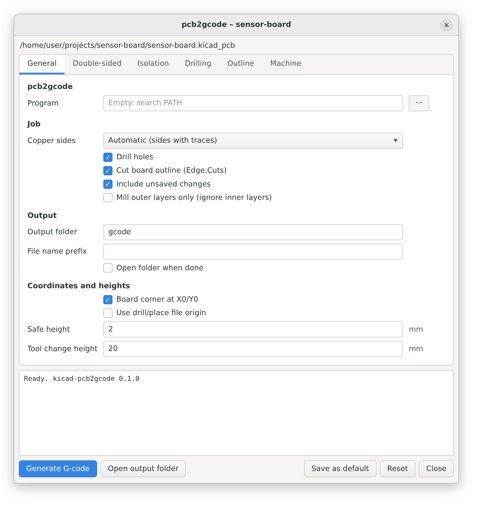
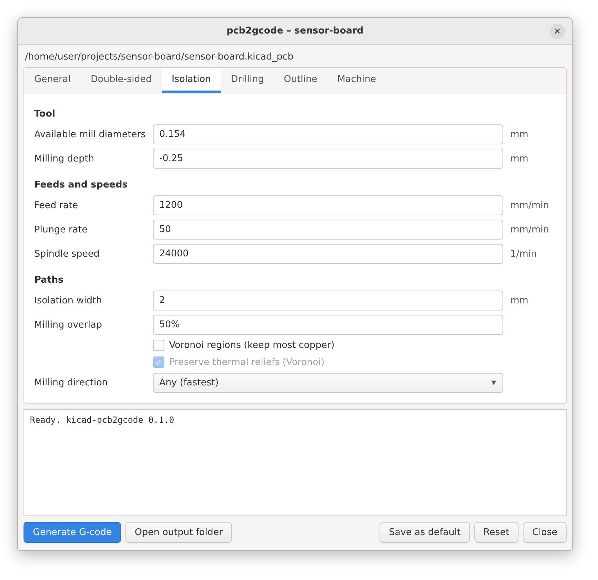
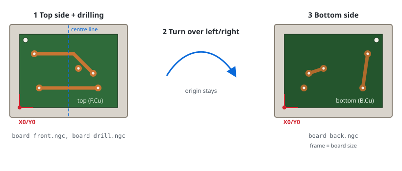
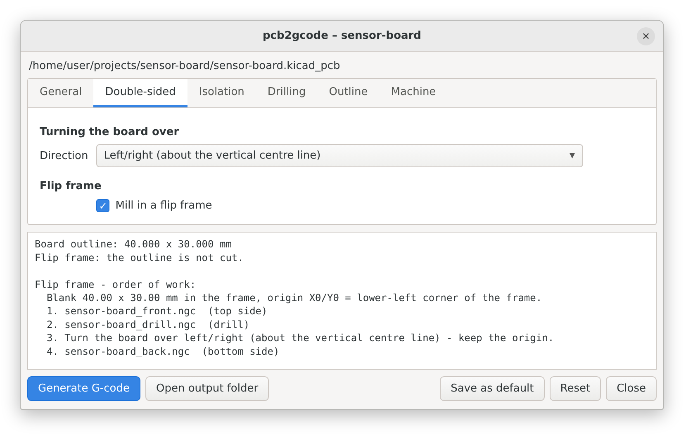

# kicad-pcb2gcode

A KiCad 9/10 plugin that turns the board open in the PCB editor into CNC
G-code with [pcb2gcode](https://github.com/pcb2gcode/pcb2gcode): isolation
milling, drilling and board outline, with defaults for GRBL machines.

*Deutsche Anleitung: [README.de.md](README.de.md)*

One click on the toolbar button opens a settings window. **Generate G-code**
then

1. exports the copper layers, `Edge.Cuts` and the drill file with `kicad-cli`
   (from a copy of the board as it is open in KiCad, so unsaved edits are
   included and your file is not touched),
2. works out which copper sides actually carry traces,
3. writes a `millproject` file and runs pcb2gcode,
4. leaves the G-code in a `gcode/` folder next to the board.

<p>
  
  
</p>

<sub>Previews drawn from the dialog's own field definitions with
<code>scripts/render_previews.py</code>. The real window follows your
operating system's look.</sub>

## Requirements

| | |
|---|---|
| KiCad | 9.0 or newer, with the API server enabled (see below) |
| pcb2gcode | 2.5 or newer (3.x recommended) – [releases](https://github.com/pcb2gcode/pcb2gcode/releases), `apt install pcb2gcode`, `brew install pcb2gcode` |
| Linux only | wxPython from the system for the settings window, e.g. `sudo apt install python3-wxgtk4.0` (KiCad packages usually pull it in) |

The plugin itself is pure Python. KiCad creates its Python environment and
installs `kicad-python` automatically.

## Installation

1. Download `kicad-pcb2gcode-<version>.zip` from the
   [releases](https://github.com/brln-devlabs/kicad-pcb2gcode/releases) and
   unzip it into KiCad's plugin folder:

   | OS | Folder |
   |---|---|
   | Windows | `Documents\KiCad\<version>\plugins\` |
   | macOS | `~/Documents/KiCad/<version>/plugins/` |
   | Linux | `~/.local/share/kicad/<version>/plugins/` |

   You should end up with `…/plugins/kicad-pcb2gcode/plugin.json`.
   Alternatively clone this repository and run `python scripts/install.py`.
2. In KiCad: **Preferences → Preferences → Plugins → Enable KiCad API**.
3. Restart KiCad. The first start takes a moment while KiCad sets up the
   plugin's Python environment. The **pcb2gcode** button then appears in the
   PCB editor toolbar.

## Usage

Open a board, press the toolbar button, check the settings, press
**Generate G-code**. The tabs:

* **General** – which copper sides to mill (automatic, top, bottom, both),
  drilling and outline on/off, output folder, origin, safe and tool-change
  heights, path to pcb2gcode.
* **Isolation** – available mill diameters (the width your tool cuts at the
  milling depth, one or several), depth, feeds, isolation width, overlap
  (percent or length), Voronoi mode – the same fields as in pcb2gcodeGUI.
* **Drilling** – depth, feed, available drill sizes, milling large holes.
* **Outline** – cutter, depth per pass, holding tabs.
* **Machine** – G-code dialect switches and extra pcb2gcode options.

The defaults suit a small GRBL router (3018 class) with a V-bit cutting
0.15 mm wide at 0.08 mm depth and a 1 mm end mill. **Always check the numbers against your tools and air-cut new
settings first.**

### Output

```
my-board/
  my-board.kicad_pcb
  my-board.pcb2gcode.json   settings of this board (commit it with the design)
  gcode/
    my-board_back.ngc       isolation milling, bottom side
    my-board_drill.ngc      drilling
    my-board_outline.ngc    board outline
    millproject             the exact pcb2gcode configuration used
    cam/                    exported Gerber and drill files
```

Run the files in your G-code sender (Candle, UGS, bCNC, CNCjs …) and change
tools in between. pcb2gcode's own autoleveller does not support GRBL; use the
height-map feature of your sender instead.

### GRBL notes

The defaults switch off what GRBL does not understand: `G64` (path blending),
`G81` (drilling cycle), `G91.1` and `M6` (tool change). With grblHAL and a
tool changer you can turn `M6` back on in the **Machine** tab.

### Origin and double-sided boards

With **Board corner at X0/Y0** (default) the lower-left corner of the board
outline (`Edge.Cuts`, line centres) is exactly X0/Y0 in every file. The
bottom side is mirrored about the board's own centre line – left/right or
top/bottom, tab **Double-sided** – so it covers the same rectangle as the
top. pcb2gcode's built-in `zero-start` is not used for this: it adds a margin
of one cutter diameter and mirrors the bottom into negative X.

#### Flip frame



For double-sided boards without alignment pins: fix a frame (or mill a
pocket) with exactly the size of the board outline on the machine and set
X0/Y0 to its lower-left corner. Cut the blank to the same size. With
**Mill in a flip frame** (tab **Double-sided**) the plugin

* does not cut the outline (the blank already has its final size),
* drills all holes from the top, before turning over,
* writes the order of work to the log and to `gcode/STEPS.txt`
  (`ABLAUF.txt` in German):

```
1. board_front.ngc   top side
2. board_drill.ngc   drill
3. turn the board over left/right in the frame – keep the origin
4. board_back.ngc    bottom side
```



For non-rectangular boards the frame has the size of the outline's bounding
rectangle. The alignment follows pcb2gcode's coordinate formulas, which
`tests/test_placement.py` reproduces; still verify on a scrap piece first.

### Boards with more than two copper layers

Isolation milling can only make the top and bottom side. Before exporting,
the plugin checks the layer stack:

* inner layers that carry tracks or zones stop the job with a message. Tick
  **Mill outer layers only** (General tab) to mill `F.Cu`/`B.Cu` anyway; the
  connections on the inner layers will then be missing;
* empty inner layers only give a note in the log;
* blind, buried and micro vias always stop the job, since they cannot be
  made by drilling.

## Settings files

* Per board: `<board>.pcb2gcode.json` next to the board, written on every run.
* Defaults for new boards and the pcb2gcode path: **Save as default** writes
  `config.json` in `%APPDATA%\kicad-pcb2gcode` (Windows),
  `~/Library/Application Support/kicad-pcb2gcode` (macOS) or
  `~/.config/kicad-pcb2gcode` (Linux).

## Command line

The same pipeline runs without KiCad on a saved board:

```
cd kicad-pcb2gcode/plugin
python -m kicad_pcb2gcode path/to/board.kicad_pcb [--sides back] [--no-outline] [--gui]
```

`python -m kicad_pcb2gcode --help` lists all options.

## Troubleshooting

* **No toolbar button** – check that the API is enabled and that
  `plugins/kicad-pcb2gcode/plugin.json` exists. On Linux, KiCad 9.0.x
  sometimes fails to create the plugin environment; try
  **Preferences → Plugins → Recreate Plugin Environment** and make sure
  `python3 -m venv` works on your system.
* **"pcb2gcode not found"** – set the program path in the **General** tab.
* **Nothing happens / no window** – without wxPython the plugin runs with the
  saved settings and writes `gcode/kicad-pcb2gcode.log`. Install wxPython
  (Linux: `python3-wxgtk4.0`).
* **pcb2gcode rejects an option** – your pcb2gcode is older than 2.5. Update
  it, or untick the option (e.g. *No M6*) in the **Machine** tab: switched-off
  options are not written at all.

## Development

```
python -m pip install pytest
python -m pytest            # unit tests and an end-to-end run with fake tools
python scripts/install.py --link   # symlink the working copy into KiCad
python scripts/package.py          # build the release zip
python scripts/render_previews.py  # redraw the dialog previews (needs Chrome and Pillow)
python scripts/flip_frame_svg.py   # redraw the flip-frame sketch
```

The code lives in `plugin/kicad_pcb2gcode/`: `settings` (model and JSON),
`millproject` (pcb2gcode configuration), `export` (kicad-cli commands),
`job` (pipeline), `kicad_bridge` (IPC API), `gui` (wxPython window).

## License

GPL-3.0-or-later, see [LICENSE](LICENSE).
